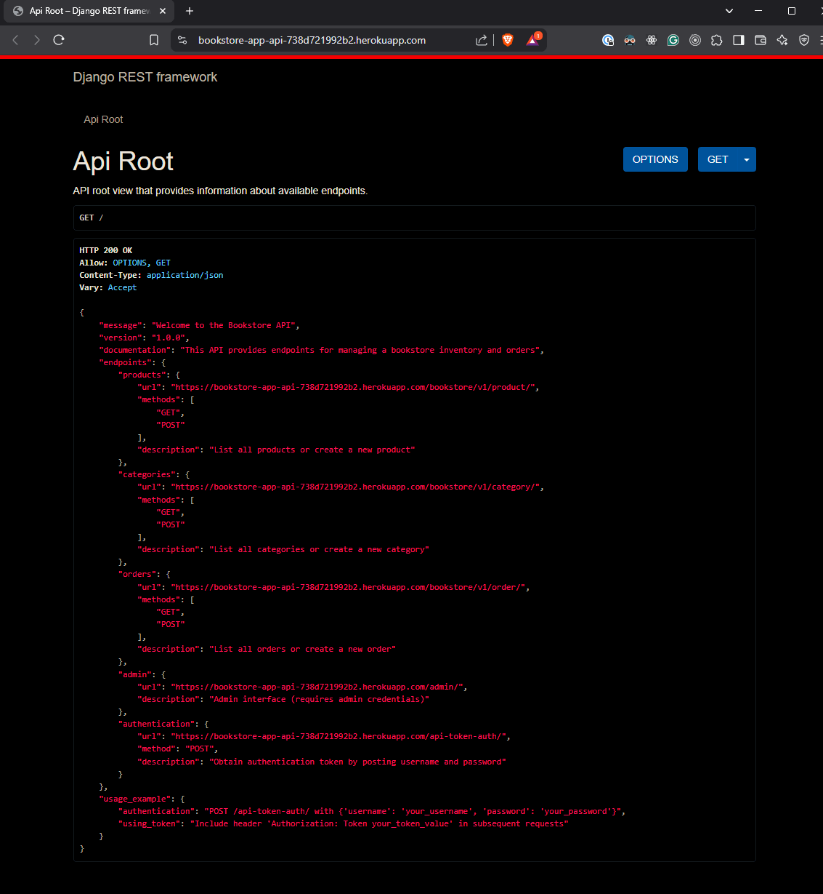
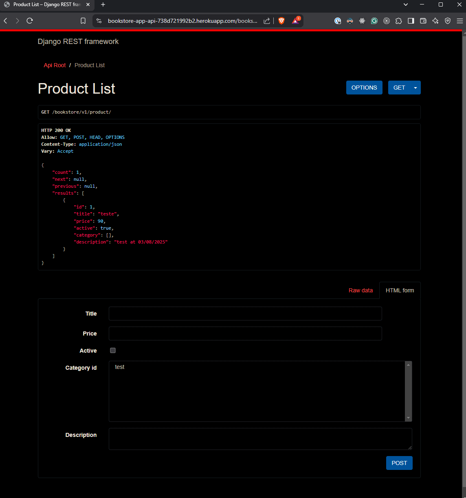
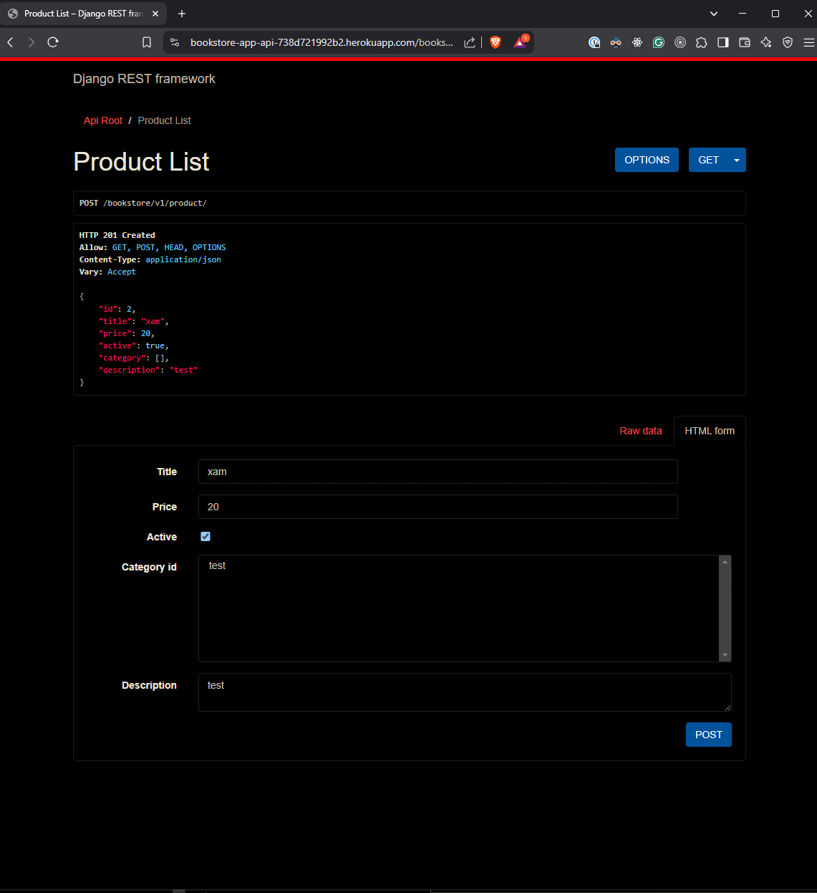
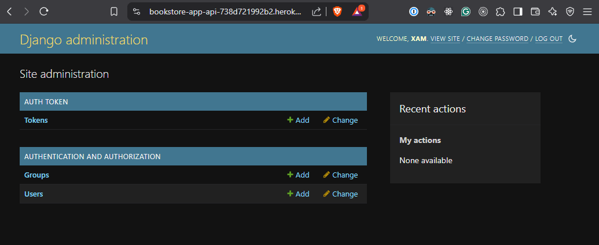

# Bookstore

Bookstore APP from Backend Python

## Overview

The Bookstore application is a backend service built with Django that allows users to manage a bookstore inventory and orders. It provides a RESTful API for interacting with products and orders, along with an admin interface for managing the application.

## Features

- User authentication with token-based authentication
- CRUD operations for products and categories
- Order management
- Admin interface for managing the bookstore
- Docker support for easy deployment and development

## Tech Stack

- **Backend**: Django 5.1.7
- **Database**: PostgreSQL
- **Containerization**: Docker
- **Dependency Management**: Poetry
- **Testing**: Django's built-in test framework, REST framework for API testing

## Core Technologies

- Django REST Framework for building APIs
- PostgreSQL for data storage
- Docker for containerization
- Whitenoise for serving static files

## Project Demo

- **Deployment Link**: [Bookstore API](https://bookstore.maxhaider.dev/)
- **Admin Panel**: [Admin Interface](https://bookstore.maxhaider.dev/admin/)
- **Images**: 
  - 
  - 
  - 
  - 

## Deployment Infrastructure Workflow

The application runs in Docker (Django + Postgres) on an Oracle Cloud ARM VPS and is published through a Cloudflare Tunnel, so no
port is open on the host. It was moved from Heroku in October 2026. The compose file, `.env` template and backup script live in
`deploy/oracle/`; GitHub Actions only runs the tests.

API writes (POST/PUT/DELETE) require a token (`POST /api-token-auth/`); reads are public.

### Deploying

On the server (`~/bookstore` holds the compose file, `.env` and backups; `~/bookstore/src` is a clone of this repo):

```shell
cd ~/bookstore/src && git pull && cd .. && docker compose up -d --build
```

`/admin` is additionally protected by Cloudflare Access. `deploy/oracle/backup.sh` takes a daily Postgres dump (14-day retention).

## How to Run

1. Clone this project

   ```shell
   git clone github.com/maxh33/bookstore
   ```

2. Install dependencies:

   ```shell
   cd bookstore
   poetry install
   ```

3. Run local dev server:

   ```shell
   poetry run manage.py migrate
   poetry run python manage.py runserver
   ```

4. Run docker dev server environment:

   ```shell
   docker-compose up -d --build 
   docker-compose exec web python manage.py migrate
   ```

5. Run tests inside of docker:

   ```shell
   docker-compose exec web python manage.py test
   ```

